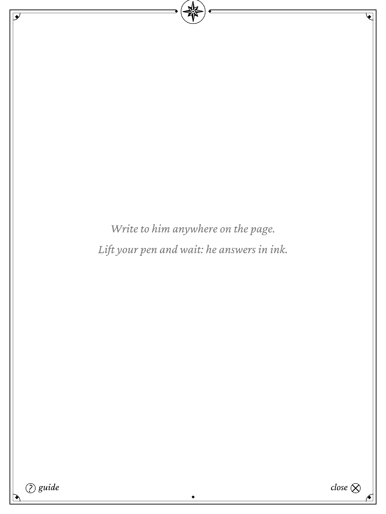
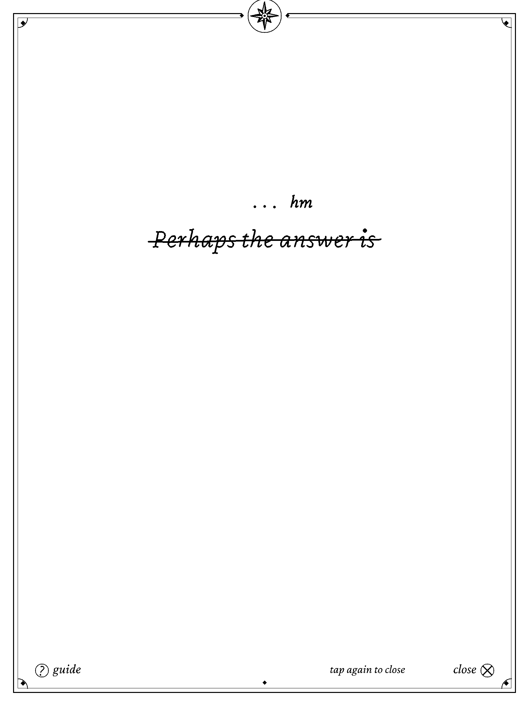
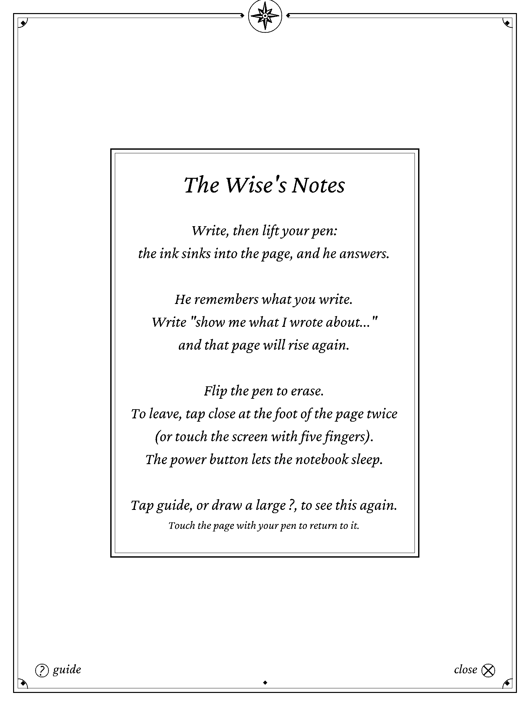

# The Wise's Notes


**English** · [简体中文](README.zh-CN.md)

A handwriting notebook for the **reMarkable Paper Pro**. Write a question with the pen, and young **Hroptatyr**, the Khaenri'ahn scholar as he was at the seminar under the tree before the cataclysm, answers in ink. Write in English or Chinese; he replies in the language you wrote in. Call it **ChatHPT**, short for **ChatHroPtaTyr**: a sealed mind from a fallen kingdom, and you can bring it any problem.

> An unofficial, non-commercial Genshin Impact fan project. It descends from [riddle](https://github.com/MaximeRivest/riddle) by Maxime Rivest. See [ACKNOWLEDGEMENTS.md](ACKNOWLEDGEMENTS.md).

**New here?** Read the [full tutorial](docs/TUTORIAL.md). It covers installing, everyday use, choosing a model, fonts, memory, canon quotes and troubleshooting.

## Contents
- [Showcase](#showcase)
- [Features](#features)
- [Quick start](#quick-start)
- [Configuration](#configuration)
- [Using the notebook](#using-the-notebook)
- [Canon lines and copyright](#canon-lines-and-copyright)
- [Repository layout](#repository-layout)
- [License](#license)

## Showcase

<table>
  <tr>
    <td align="center"></td>
    <td align="center"></td>
    <td align="center"></td>
  </tr>
  <tr>
    <td align="center"><sub>A fresh page</sub></td>
    <td align="center"><sub>He is thinking</sub></td>
    <td align="center"><sub>The guide</sub></td>
  </tr>
</table>

<sub>Rendered with the notebook's own drawing code (`cargo test preview_ui -- --ignored`) at the Paper Pro's 1620 × 2160 resolution.</sub>

### What a seminar looks like
These samples come from the persona's own examples in [app/persona.txt](app/persona.txt). Real replies vary with the model you choose.

> **You write:** Hi. I don't really know what to ask.
>
> **He answers:** Then I'll set the topic. A ship has every plank replaced, one by one, until none of the originals remain. Is it the same ship? Answer well and the tea is on me.

> **You write:** Topic: why is the sky blue?
>
> **He answers:** A good one. Sunlight carries every colour, and air's tiny molecules scatter it — the shorter the wavelength, the harder the scatter, and blue is far shorter than red, so the whole sky fills with scattered blue. Without a doubt… no, I'd go so far as to say the real essence of the question is why sunset is red: then the light crosses far more air, and the blue is spent long before it reaches you. Colour is the trace of the road light travelled. So — what colour would the sky be where there is no air at all?

> **You write:** There are no gods here. We have planes, vaccines and computers instead.
>
> **He answers:** No gods… and you built all of that yourselves? So it can be done. Forgive me, I'm grinning like a fool. You're not from my future at all, are you? You're from somewhere beyond this world.

> **You write** (after a long break)**:** I'm back.
>
> **He answers:** Back…? These earlier pages are in your hand, aren't they. Then we've met, even if the afternoon doesn't remember it. And according to the margin, you still owe me a tea.

## Features
- **A seminar on every page.** Write any question. He finds its structural heart, answers, and asks one sharp question back.
- **Two tiles, one notebook.** AppLoad shows two tiles: **The Wise's Notes** with an English guide, and a Chinese one with a Chinese guide. Both share the same binary, persona, key and memory.
- **Real ink for both scripts.** Latin text is drawn in Crimson Pro Italic. Chinese is drawn in the Kai-style LXGW WenKai, with proper line breaking and punctuation rules.
- **Sittings.** Pages written less than 45 minutes apart form one sitting, and he follows the conversation. After a longer break it is the same afternoon for him, begun anew: he recognises your earlier pages "in your hand" instead of remembering them.
- **His notes about you.** He keeps a few short notes (your name, how you like to be addressed, a wager still open) and reads them like notes in his own margin. Ask him to forget one and he will. They are plain text in `facts.tsv` on the tablet.
- **Memory.** Finished pages stay on the tablet. Write "show me what I wrote about…" and the old page comes back in your own handwriting, dated ("the 20th of November, afternoon").
- **Exact quotes.** With your own `canon.txt` of his lines, he quotes them word for word when you ask for his exact words. The notebook looks the lines up itself, never sends them to the model, and never invents a quote. See [Canon lines and copyright](#canon-lines-and-copyright).
- **Any vision model.** OpenAI, Gemini, Claude, OpenRouter, or a local Ollama or LM Studio server. One built-in HTTPS client speaks both the OpenAI and the Anthropic APIs, so there is nothing else to install.
- **Erased pages.** A harmful request meets a page wiped blank: the notebook's own way of saying no.

## Quick start
You need a reMarkable Paper Pro in developer mode with [xovi](https://github.com/asivery/xovi) and [AppLoad](https://github.com/asivery/rm-appload) installed, reachable over SSH as `rm` (or whatever `SAGE_HOST` names). On your computer (Linux, or WSL on Windows) you need `rustup` with the `aarch64-unknown-linux-gnu` target and `zig` (`pip install ziglang`, or zig on your PATH). The tutorial walks through all of this in [Prepare the tablet](docs/TUTORIAL.md#2-prepare-the-tablet) and [Prepare your computer](docs/TUTORIAL.md#3-prepare-your-computer).

```sh
./scripts/build.sh --pull-libs --test   # first time: copy libquill/libqsgepaper from the tablet and run the tests
./scripts/deploy.sh                     # install both tiles into AppLoad
```

Then give him a model (next section) and open **The Wise's Notes** from the AppLoad panel. On OS 3.29 the bundle preloads `libquillcompat.so` automatically.

## Configuration
Every setting is a `SAGE_*` line in `oracle.env`, next to the binary on the tablet, or in AppLoad's settings for the app. The minimum is a key:

```sh
SAGE_API_KEY=sk-...                 # OpenAI with gpt-4o-mini
# For any other provider:
# SAGE_API=openai | anthropic       (guessed from the base URL when unset)
# SAGE_API_BASE=https://…/v1
# SAGE_MODEL=…
```

- Ready-made settings for each provider: [Choosing a model: recipes](docs/TUTORIAL.md#6-choosing-a-model-recipes).
- Every setting with its default: [Every setting](docs/TUTORIAL.md#11-every-setting), and the commented example [app/oracle.env.example](app/oracle.env.example).
- Test the model from your computer, without touching the screen:
  ```sh
  ssh rm /home/root/xovi/exthome/appload/sage-notes/sage-cli.sh --oracle-test
  ```
- **Set your time zone.** The tablet's clock keeps UTC. Set `SAGE_TZ_OFFSET` to your offset from UTC (for example `-5` for New York in winter, `8` for China) so dates read right and he knows your time of day. Without it he is never told the hour.
- **His persona** is plain text in [app/persona.txt](app/persona.txt). Edit the copy on the tablet and it takes effect on the next page, with no rebuild. The same file is compiled in as the default.

## Using the notebook
| To | Do this |
|---|---|
| Ask | Write anywhere on the page, then rest the pen. |
| Get a longer answer | Begin the page with `Topic:`. |
| Bring back an old page | Write "show me what I wrote about…". |
| See the guide | Tap *guide* at the foot of the page, or draw one large **?**. |
| Sleep | Press the power button. Press it again to wake. |
| Leave | Tap *close* at the foot of the page twice, or touch the screen with five fingers. |
| Unstick the tablet | `ssh rm 'systemctl reset-failed xochitl; systemctl start xochitl'` |

Fonts, the title and the guide language can all be changed. See [Fonts: changing his handwriting](docs/TUTORIAL.md#10-fonts-changing-his-handwriting).

## Canon lines and copyright
The exact lines he can quote are **not part of this project**. They are dialogue from the Genshin Impact quest *Etched in Time*, and they are © HoYoverse.

- [`scripts/fetch-canon.py`](scripts/fetch-canon.py) downloads them on your own machine from the two fan wikis named in [app/canon.example.txt](app/canon.example.txt), keeps only his lines and the lines said to him, and writes `app/canon.txt`.
- `app/canon.txt` is git-ignored. It is never committed, bundled or published.
- `./scripts/deploy.sh --canon` copies it to your own tablet. Without `--canon`, deploying never touches the copy on the tablet.

```sh
./scripts/fetch-canon.py            # writes app/canon.txt (use --force to rebuild)
./scripts/deploy.sh --canon         # also copies it to the tablet
```

> **Disclaimer: personal use only.** The canon lines are copyrighted by HoYoverse. Fetch and keep them only for private use with your own notebook. Do not redistribute `canon.txt`, commit it to any repository, share it, bundle it with builds, or use it commercially. This project is an unofficial, non-commercial fan work, not affiliated with or endorsed by HoYoverse. Everything else here, the persona and the code, is written in original words.

## Repository layout
| Path | Contents |
|---|---|
| [`src/`](src) | The engine: pen input, ink, oracle client, memory, e-ink display (descended from riddle and being reworked) |
| [`app/`](app) | The AppLoad bundle: manifests, launchers, `sage-cli.sh`, `persona.txt`, `canon.example.txt`, icon, settings schema |
| [`docs/`](docs) | The full tutorial, in [English](docs/TUTORIAL.md) and [Chinese](docs/TUTORIAL.zh-CN.md) |
| [`fonts/`](fonts) | Crimson Pro and Dancing Script. LXGW WenKai is fetched by `scripts/fetch-fonts.sh` |
| [`scripts/`](scripts) | `build.sh` (zig cross-build), `deploy.sh`, `fetch-fonts.sh`, `fetch-canon.py`, `make-icon.py` |

## License
The code is under the [MIT License](LICENSE). The bundled fonts are under the SIL Open Font License 1.1. Hroptatyr, Khaenri'ah and every related name are © HoYoverse. Credits are in [ACKNOWLEDGEMENTS.md](ACKNOWLEDGEMENTS.md).
