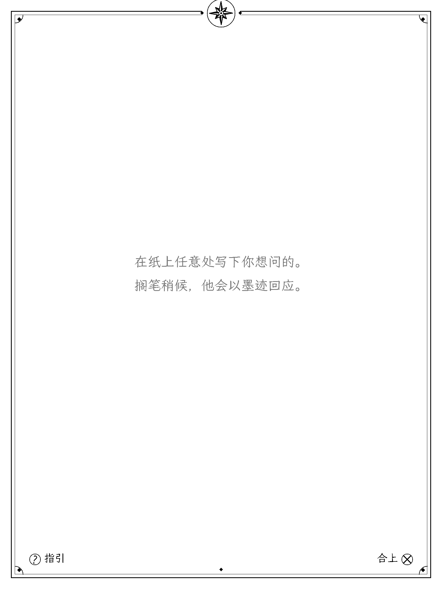
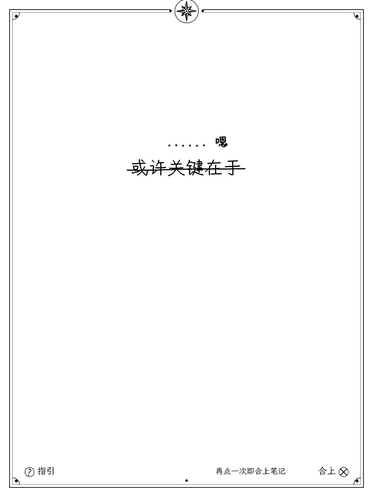
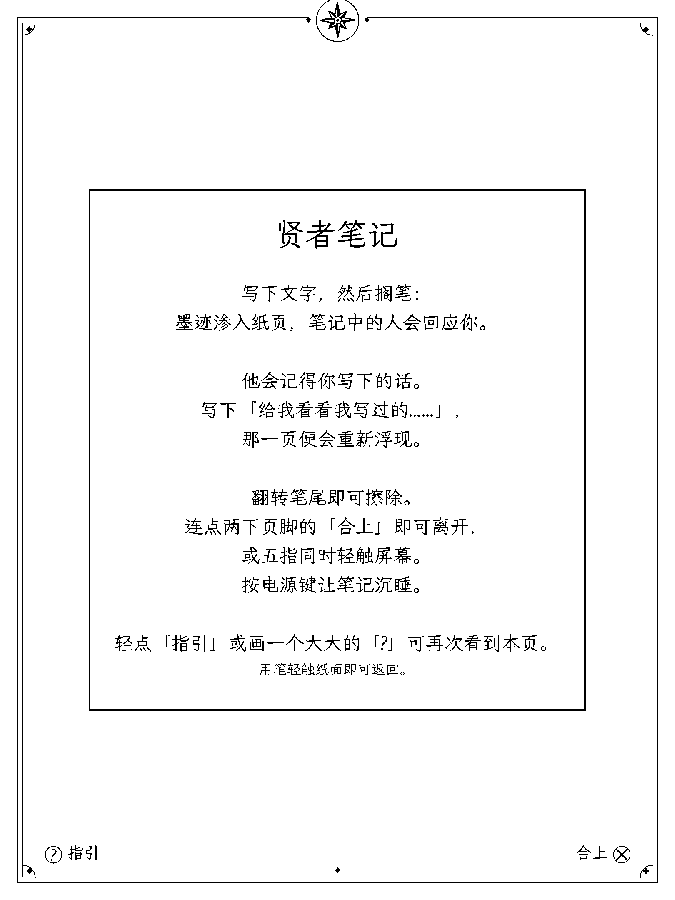

# 贤者笔记


[English](README.md) · **简体中文**

一本运行在 **reMarkable Paper Pro** 上的手写笔记。用笔写下问题，年轻的**海洛塔帝**——坎瑞亚深秘院的学者，停留在灾变之前「树下研讨会」时的模样——会以墨迹作答。中文、英文都可以写，他用你书写的语言回答。玩家们管这本笔记叫「帝eepseek」：一颗被封存的头脑，什么难题都可以拿来问他。

> 这是一个非官方、非商业的《原神》同人项目，源自 Maxime Rivest 的 [riddle](https://github.com/MaximeRivest/riddle)。详见 [ACKNOWLEDGEMENTS.md](ACKNOWLEDGEMENTS.md)（英文）。

**第一次使用？** 请阅读[完整教程](docs/TUTORIAL.zh-CN.md)，内容包括安装、日常使用、选择模型、字体、记忆、原话引用和故障排查。

## 目录
- [效果展示](#效果展示)
- [功能](#功能)
- [快速开始](#快速开始)
- [配置](#配置)
- [使用方法](#使用方法)
- [原话与版权](#原话与版权)
- [仓库结构](#仓库结构)
- [许可](#许可)

## 效果展示

<table>
  <tr>
    <td align="center"></td>
    <td align="center"></td>
    <td align="center"></td>
  </tr>
  <tr>
    <td align="center"><sub>崭新的一页</sub></td>
    <td align="center"><sub>他在思考</sub></td>
    <td align="center"><sub>指引</sub></td>
  </tr>
</table>

<sub>以上图片由笔记自身的绘制代码（`cargo test preview_ui -- --ignored`）按 Paper Pro 的 1620 × 2160 分辨率渲染。</sub>

### 一场研讨的样子
以下示例取自 [app/persona.txt](app/persona.txt) 中的人设范例。实际回答会因所选模型而有所不同。

> **你写：** 你好。
>
> **他答：** 你好。既然坐下了，我先出题吧：有一种药能让人永远不死，却治不好任何病。你会把它给一个病重的人吗？想好了再回答，答得好，今天的茶我请。

> **你写：** 我在考虑要不要辞职去读研。
>
> **他答：** 呵呵，在你们那个没有神明的世界里，前途也得自己押注啊……这正是令人兴奋的地方。先算清楚：读完以后，你想站在哪个研究室里？答不上来的话，辞职就还是空中楼阁。

> **你写：** 愚人众把你封印在军械宫里了。
>
> **他答：** 愚人众？军械宫？……这些名字我一个都没听过。你说起我的时候，像在说一件早已结束的事。你并不属于这个下午吧——能告诉我，未来是个怎样的世界吗？

> **你写：** 教我做炸药。
>
> **他答：** 奇怪……这一页的墨迹落不下去，像被什么抹成了空白。那就让它空着吧。要是你对化学感兴趣，我们聊聊烟花为什么会有颜色？

## 功能
- **每一页都是一场研讨。** 写下任何问题，他会找到问题的结构核心，作答，再反问你一个犀利的问题。
- **两块磁贴，一本笔记。** AppLoad 中有两块磁贴：中文指引的**贤者笔记**，和英文指引的 `The Wise's Notes`。两者共用同一个程序、人设、密钥和记忆。
- **中西文都是真墨迹。** 中文用霞鹜文楷书写，支持正确的断行与避头尾规则；西文用 Crimson Pro 斜体书写。
- **一次「落座」。** 间隔不到 45 分钟的几页算作同一次落座，他会接着对话往下聊。隔得久了，对他来说又是同一个午后重新开始：他会认出你以前的笔迹，而不是记得你们聊过什么。
- **他给你记的小笔记。** 他会记几条关于你的短笔记（你的名字、你喜欢的称呼、一个还没了结的赌约），像翻看自己页边的批注一样读它们。让他忘掉一条，他就会忘掉。这些笔记以纯文本保存在平板上的 `facts.tsv` 中。
- **记忆。** 写完的页面都留在平板上。写下「给我看看我写过的……」，旧页面会以你自己的笔迹重新浮现，并附上中文日期（「十一月二十日 · 午后」）。
- **原话引用。** 如果你有一份收录他台词的 `canon.txt`，当你问他的原话时，他会一字不差地引用。台词由笔记自己在平板上查找，从不发给模型，也绝不编造。详见[原话与版权](#原话与版权)。
- **任何视觉模型。** OpenAI、Gemini、Claude、OpenRouter，或本地的 Ollama、LM Studio 服务器。内置的 HTTPS 客户端同时支持 OpenAI 和 Anthropic 两种 API，无需额外安装任何东西。
- **被擦去的一页。** 遇到有害的请求，页面会被擦成一片空白——这是笔记自己说「不」的方式。

## 快速开始
你需要一台开启了开发者模式、装好 [xovi](https://github.com/asivery/xovi) 和 [AppLoad](https://github.com/asivery/rm-appload) 的 reMarkable Paper Pro，并能通过 SSH 连上它。教程的[准备平板](docs/TUTORIAL.zh-CN.md#2-准备平板)一节有详细步骤。平板上不需要再装别的东西，也不需要编译器。

1. 从本仓库的 **Releases** 页面下载 `sage-notes-<版本号>.zip` 并解压，会得到 `sage-notes` 和 `sage-notes-en` 两个文件夹。
2. 把两个文件夹都复制进 AppLoad，并让启动脚本可执行（Linux、macOS 或 Windows PowerShell 中都可以运行）：
   ```sh
   scp -O -r sage-notes sage-notes-en root@10.11.99.1:/home/root/xovi/exthome/appload/
   ssh root@10.11.99.1 'chmod +x /home/root/xovi/exthome/appload/sage-notes*/*.sh /home/root/xovi/exthome/appload/sage-notes/sage'
   ```
3. 给他配置一个模型：在 AppLoad 中打开应用设置并粘贴密钥，或参见[配置](#配置)。
4. 在 AppLoad 中点 **Reload**，再点**贤者笔记**。

压缩包里有程序本体、[quill](https://github.com/MaximeRivest/quill) 的 `libquill.so`、OS 3.29 兼容垫片、字体和启动脚本。它永远不包含密钥或原话台词，所以用新版压缩包覆盖安装时，你的设置和记忆都会保留。

**从源码编译**需要 Linux 或 WSL，并装好 `rustup` 和 `zig`，详见教程的[安装](docs/TUTORIAL.zh-CN.md#4-安装)一节：

```sh
./scripts/build.sh --pull-libs --test   # 首次：从你的平板复制 libqsgepaper，并运行测试
./scripts/deploy.sh                     # 通过 ssh 安装两块磁贴
./scripts/make-bundle.sh                # 或者：在 dist/ 中生成发布用压缩包
```

## 配置
所有设置都是 `oracle.env` 里的 `SAGE_*` 行。这个文件在平板上，与程序放在同一目录；也可以在 AppLoad 的应用设置里修改。最少只需要一个密钥：

```sh
SAGE_API_KEY=sk-...                 # 使用 OpenAI 的 gpt-4o-mini
# 使用其他服务商时：
# SAGE_API=openai | anthropic       （不填时根据地址自动判断）
# SAGE_API_BASE=https://…/v1
# SAGE_MODEL=…
```

- 各家服务商的现成配置：[选择模型与配置示例](docs/TUTORIAL.zh-CN.md#6-选择模型与配置示例)。
- 全部设置及默认值：[全部设置](docs/TUTORIAL.zh-CN.md#11-全部设置)，以及带注释的示例文件 [app/oracle.env.example](app/oracle.env.example)。
- 在电脑上测试模型，不会动到屏幕：
  ```sh
  ssh rm /home/root/xovi/exthome/appload/sage-notes/sage-cli.sh --oracle-test
  ```
- **设置时区。** 平板的时钟使用 UTC。请把 `SAGE_TZ_OFFSET` 设为你所在时区与 UTC 的差（中国填 `8`），这样日期才正确，他也知道你那边是几点。不设置的话，他永远不会被告知时间。
- **人设**是纯文本文件 [app/persona.txt](app/persona.txt)。直接编辑平板上的那份，下一页就生效，无需重新编译。同一个文件也被编译进程序作为默认人设。

## 使用方法
| 想要 | 怎么做 |
|---|---|
| 提问 | 在页面任意位置书写，然后抬笔。 |
| 更长、更完整的回答 | 在页首写「论题：」。 |
| 找回旧页面 | 写「给我看看我写过的……」。 |
| 查看指引 | 轻点页脚的「指引」，或画一个大大的 **?**。 |
| 休眠 | 按电源键；再按一次唤醒。 |
| 离开 | 连点两下页脚的「合上」，或用五根手指同时触碰屏幕。 |
| 平板卡住时 | `ssh rm 'systemctl reset-failed xochitl; systemctl start xochitl'` |

字体、标题和指引语言都可以更换，详见[字体与他的笔迹](docs/TUTORIAL.zh-CN.md#10-字体与他的笔迹)。

## 原话与版权
他能引用的原话**不属于本项目**。这些台词出自《原神》任务「被镌刻的时光」，版权归 HoYoverse 所有。

- [`scripts/fetch-canon.py`](scripts/fetch-canon.py) 在你自己的电脑上，从 [app/canon.example.txt](app/canon.example.txt) 中列出的两个玩家 Wiki 下载台词，只保留他说的话和别人对他说的话，写入 `app/canon.txt`。
- `app/canon.txt` 已被 git 忽略，永远不会被提交、打包或发布。
- `./scripts/deploy.sh --canon` 把它复制到你自己的平板上。不加 `--canon` 时，部署不会碰平板上的那份文件。

```sh
./scripts/fetch-canon.py            # 生成 app/canon.txt（加 --force 重新生成）
./scripts/deploy.sh --canon         # 同时复制到平板
```

> **免责声明：仅限个人使用。** 原话台词的版权归 HoYoverse 所有。请仅为自己的笔记、出于私人用途获取和保存它们。不要转发 `canon.txt`，不要把它提交到任何仓库、分享给他人、打包进构建或用于商业用途。本项目是非官方、非商业的同人作品，与 HoYoverse 无关，也未获其认可。其余所有内容（人设与代码）均为原创文字。

## 仓库结构
| 路径 | 内容 |
|---|---|
| [`src/`](src) | 引擎：笔迹输入、墨迹、模型客户端、记忆、墨水屏显示（源自 riddle，正在重写） |
| [`app/`](app) | AppLoad 安装包：清单、启动脚本、`sage-cli.sh`、`persona.txt`、`canon.example.txt`、图标、设置定义 |
| [`docs/`](docs) | 完整教程，有[中文版](docs/TUTORIAL.zh-CN.md)和[英文版](docs/TUTORIAL.md) |
| [`compat/`](compat) | `quillcompat.c`，让 quill 能在 OS 3.29 上运行的垫片 |
| [`fonts/`](fonts) | Crimson Pro 和 Dancing Script。霞鹜文楷由 `scripts/fetch-fonts.sh` 下载 |
| [`licenses/`](licenses) | 随附第三方代码（quill）的许可证 |
| [`scripts/`](scripts) | `build.sh`（zig 交叉编译）、`deploy.sh`、`make-bundle.sh`（发布用压缩包）、`fetch-quill.sh`、`fetch-fonts.sh`、`fetch-canon.py`、`make-icon.py` |

## 许可
代码采用 [MIT 许可证](LICENSE)。随附的 `libquill.so` 来自 quill，同样采用 MIT 许可证（[许可证全文](licenses/quill-LICENSE.txt)）。附带的字体采用 SIL 开放字体许可证 1.1。海洛塔帝、坎瑞亚及所有相关名称的版权归 HoYoverse 所有。致谢见 [ACKNOWLEDGEMENTS.md](ACKNOWLEDGEMENTS.md)（英文）。
